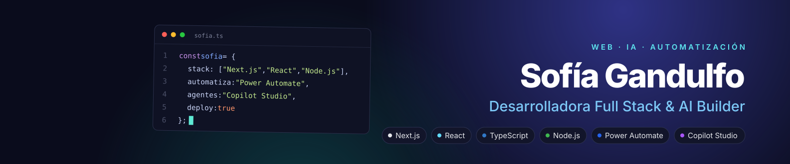

  
  
  

## 👩‍💻 Sobre mí

Desarrolladora **Full Stack & AI Builder** de Buenos Aires. Combino desarrollo web con **Next.js, React y TypeScript** con la automatización de procesos usando **Power Automate y Copilot Studio**. Me gusta trabajar de punta a punta: entender el problema, desarrollar la solución y ponerla en producción.

- 🎟️ Desarrollo y mantengo **Club de Rifas**, una plataforma en producción con más de 1.800 usuarios registrados.
- 🤖 Como **AI Builder** automaticé procesos de RR. HH. y Finanzas, reduciendo hasta un 90% el tiempo de tareas manuales.
- 🎓 Estudio la Tecnicatura en Desarrollo Web en la **UNLaM**.

## 🚀 Proyectos destacados

| Proyecto | Qué es | Stack | |
|---|---|---|---|
| **Club de Rifas** | Plataforma de rifas online con pagos y login con Google | Next.js · MongoDB · JWT · PayPal | [Ver sitio](https://clubderifas.com) |
| **[Teatron Web](https://github.com/sofigandulfo/teatron-web)** | Reserva de asientos en tiempo real para eventos teatrales | React · Firebase | [Ver sitio](https://teatron-web.vercel.app) |
| **[SubTrack](https://github.com/sofigandulfo/challenge-tecnico)** | App para gestionar suscripciones, con tests y CI | Next.js · Supabase · Vitest | [Ver sitio](https://challenge-tecnico.vercel.app) |
| **[Invitación de casamiento](https://github.com/sofigandulfo/invitacion-casamiento)** | Invitación web para un casamiento real | React · CSS | [Ver sitio](https://invitacion-casamiento-one.vercel.app) |

## 🛠️ Stack

<h4 align="center">Frontend</h4>

  

<h4 align="center">Backend y datos</h4>

  

<h4 align="center">Herramientas</h4>

  

<h4 align="center">Automatización e IA</h4>

  
  
  
  

## 📊 Actividad

  

